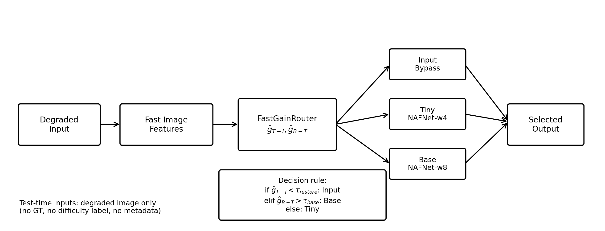
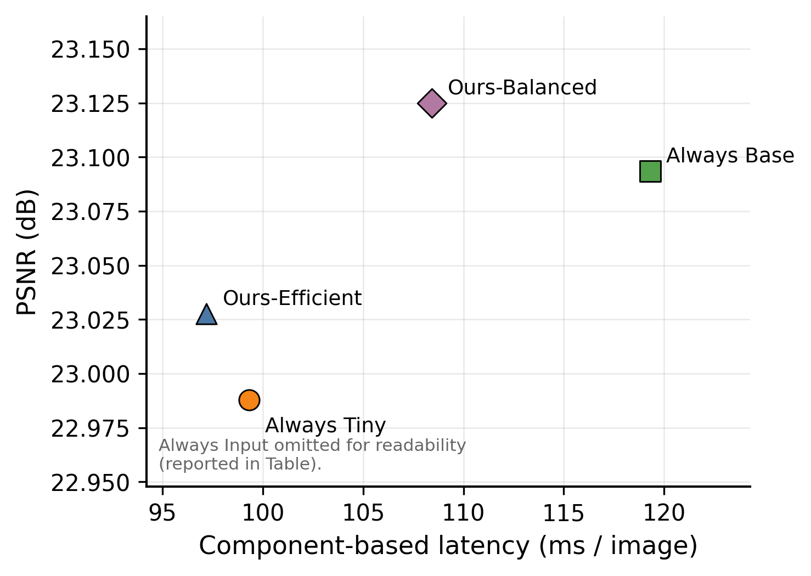
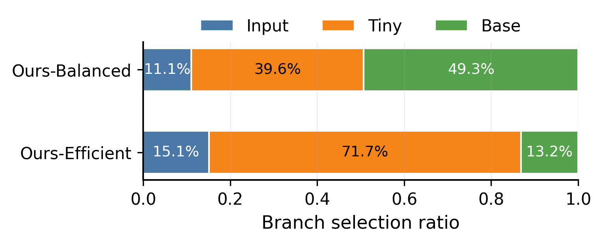
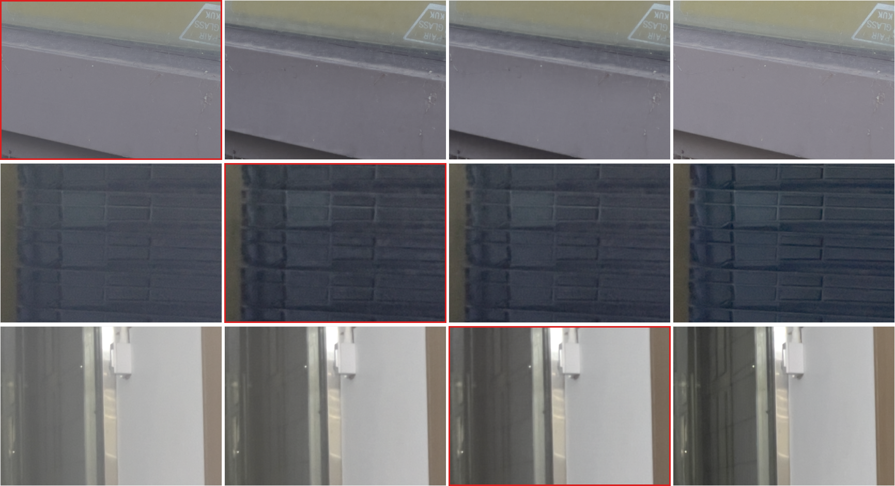

# FastGainRouter
## Input-Adaptive Efficient Restoration for Smartphone Images with Dirty Lenses

**Does every dirty-lens image need the same restoration budget?**

FastGainRouter selects whether to bypass restoration, apply a lightweight model, or use a stronger model for each degraded image. It predicts restoration gains from nine inexpensive image statistics and allocates computation through an input-adaptive routing policy.

**An individual project for the Deep Learning Programming course at Soongsil University.**

**Developed by:** [Donggyun Seo](https://github.com/seo6347) · Department of AI Software, Soongsil University

[Project Report (PDF)](paper/FastGainRouter_Input-Adaptive_Efficient_Restoration_for_Smartphone_Images_with_Dirty_Lenses.pdf) · [Main Results](results/final_compact_main_table_v1.md) · [Experiment Notes](docs/reproduce.md)

The accompanying report documents the method and experiments and has not been submitted for publication.

## Overview

Applying the same restoration model to every input can waste computation or introduce unnecessary changes. On the SIDL validation set, the Input, Tiny, and Base branches are individually optimal for **27.0%, 27.8%, and 45.2%** of samples under PSNR, respectively. These ground-truth-based oracle statistics motivate adaptive routing; they are not the router's predicted branch usage.

FastGainRouter explores this problem with three branches:

| Branch | Operation |
| --- | --- |
| **Input** | Return the degraded input unchanged. |
| **Tiny** | Restore the image with a width-4 NAFNet variant. |
| **Base** | Restore the image with a width-8 NAFNet variant. |

The project focuses on **when to use each restoration branch**, rather than introducing a new restoration backbone.

## Project Highlights

- **Analyze restoration-budget diversity:** identify inputs for which bypassing restoration, using Tiny, or using Base yields the best PSNR.
- **Formulate routing as gain prediction:** predict Tiny-over-Input and Base-over-Tiny gains instead of directly classifying hard oracle labels.
- **Evaluate quality–latency trade-offs:** demonstrate two calibrated operating points that reduce estimated average pipeline latency with near-Base PSNR.

## Method

### 1. Extract features from the degraded input

The router uses nine image statistics:

- Grayscale mean and standard deviation.
- Dark and bright pixel ratios.
- HSV saturation mean and standard deviation.
- HSV value mean and standard deviation.
- Laplacian variance.

Ground-truth images, task metadata, and difficulty labels are **not used as routing inputs at inference time**.

### 2. Predict restoration gains

For training, branch outputs are compared with the reference image to compute:

- **Tiny-over-Input gain:** PSNR(Tiny) − PSNR(Input).
- **Base-over-Tiny gain:** PSNR(Base) − PSNR(Tiny).

The released training code includes Ridge and Random Forest regressors. The reported FastGainRouter operating points use **Random Forest gain regression (RFGain)**.

### 3. Select a branch

The policy first checks whether restoration is worthwhile, then whether Base provides enough additional benefit:

1. If predicted Tiny-over-Input gain is below `tau_restore`, select **Input**.
2. Otherwise, if predicted Base-over-Tiny gain exceeds `tau_base`, select **Base**.
3. Otherwise, select **Tiny**.

Thresholds are calibrated on the inner validation split.

| Operating point | tau_restore | tau_base | Selected Input / Tiny / Base on official validation |
| --- | ---: | ---: | --- |
| **Balanced** | 0.3 | 0.1 | 11.1% / 39.6% / 49.3% |
| **Efficient** | 0.6 | 0.5 | 15.1% / 71.7% / 13.2% |

Balanced and Efficient are two threshold settings of the **same gain-based router**, not separately trained restoration models.

## Main Results

Results are reported on **5,520 samples from the official SIDL validation split**.

| Method | PSNR ↑ | SSIM ↑ | LPIPS ↓ | Estimated latency (ms/image) ↓ | ΔPSNR vs Base | Latency reduction vs Base |
| --- | ---: | ---: | ---: | ---: | ---: | ---: |
| Always Input | 21.6725 | 0.8070 | 0.2573 | 0.00 | −1.4210 | — |
| Always Tiny | 22.9878 | 0.8082 | 0.2420 | 99.31 | −0.1057 | 16.7% |
| Always Base | 23.0935 | 0.8145 | 0.2399 | 119.29 | 0.0000 | 0.0% |
| **FastGainRouter — Balanced** | **23.1250** | 0.8141 | 0.2406 | **108.43** | **+0.0315** | **9.1%** |
| **FastGainRouter — Efficient** | **23.0276** | 0.8119 | 0.2424 | **97.19** | **−0.0659** | **18.5%** |

- **Balanced:** slightly higher PSNR than Always Base with a 9.1% latency reduction.
- **Efficient:** an 18.5% latency reduction relative to Always Base with a 0.0659 dB PSNR decrease.
- Compared with Always Tiny, Efficient improves PSNR by about 0.040 dB and reduces latency by about 2.1%.

**Latency interpretation.** Reported latency is a measured **component-based pipeline estimate**: feature extraction + batch router prediction + selected branch inference. It represents a batch/offline evaluation setting, not an optimized single-image deployment benchmark. Always Input's zero denotes bypassing restoration within this accounting, not zero image-loading or application overhead.

**Metric interpretation.** The main claim is an improved **PSNR–latency trade-off**. Balanced does not outperform Always Base on every quality metric; Efficient also has a slightly worse LPIPS than Always Tiny.

Numerical summaries: [CSV](results/final_compact_main_table_v1.csv) · [Markdown table](results/final_compact_main_table_v1.md) · [Key claims](results/final_compact_key_claims_v1.txt).

## Experimental Protocol

Internal splits are constructed at the **case level**, keeping patches from the same case together.

| Split | Source | Samples | Role |
| --- | --- | ---: | --- |
| `train_inner` | Official SIDL training split | 51,264 | Restoration branch training and router gain-target generation |
| `es_val_inner` | Official SIDL training split | 5,616 | Early stopping, checkpoint selection, and routing-threshold calibration |
| Official validation | Official SIDL validation split | 5,520 | Held-out final evaluation |

The router learns from gain targets generated on the same `train_inner` split used to train the restoration branches. The official validation split remains held out, but cross-fitting or a separate router-training split would provide a stricter target-generation protocol.

## Qualitative Examples

The figure illustrates bypass, Tiny-sufficient, and Base-selected cases. The red outline marks the selected branch; ground truth is shown for comparison only. These examples illustrate routing behavior rather than visual superiority on every sample.

## Released Materials

This repository releases **project code, experiment configurations, result summaries, and report assets** for inspecting the method and reported findings.

| Path | Contents |
| --- | --- |
| [scripts/](scripts/) | Training orchestration, branch inference, feature extraction, gain regression, and result-generation scripts |
| [configs/](configs/) | Training and evaluation configurations |
| [results/](results/) | Aggregated numerical results and analysis summaries |
| [figures/](figures/) | Method overview and selected experiment figures |
| [paper/](paper/) | Project report PDF, source, bibliography, and figures |
| [docs/reproduce.md](docs/reproduce.md) | Original experiment workflow and environment assumptions |
| [docs/data_and_weights.md](docs/data_and_weights.md) | Data, model dependencies, and excluded artifacts |

The original scripts retain experiment-specific paths and dependencies. Raw SIDL data, restoration checkpoints, router model artifacts, and bulk intermediate outputs are not included. This is a **code and results release**, rather than a self-contained reproduction package.

The PDF is the primary reading version of the report. The report source may require figure-reference adjustments before recompilation.

## Scope and Limitations

- Evaluated on SIDL with an Input/Tiny/Base family built from NAFNet variants; generalization to other datasets and backbones is not established.
- Latency is estimated from measured components and includes batch router prediction; deployment runtime requires separate validation.
- Quality gains are small and should be interpreted alongside SSIM, LPIPS, and qualitative examples.
- Router targets are generated from restoration-training samples, as described above.

## Project Role & References

**Donggyun Seo** independently carried out project planning, routing-method design, implementation, model training, evaluation, result analysis, and report writing.

This project builds on existing research resources:

- **SIDL:** Sooyoung Choi, Sungyong Park, and Heewon Kim. *SIDL: A Real-World Dataset for Restoring Smartphone Images with Dirty Lenses.* AAAI, 2025.
- **NAFNet:** Liangyu Chen, Xiaojie Chu, Xiangyu Zhang, and Jian Sun. *Simple Baselines for Image Restoration.* ECCV, 2022.

Dataset creation and the original NAFNet architecture are credited to their respective authors. Full references are included in the [project report](paper/FastGainRouter_Input-Adaptive_Efficient_Restoration_for_Smartphone_Images_with_Dirty_Lenses.pdf) and [bibliography](paper/references.bib).
